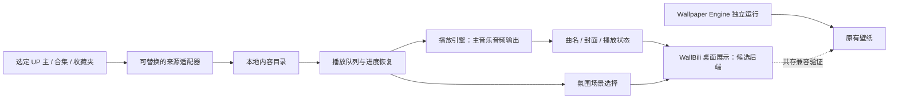

**WallBili 技术调研与路线规划**

调研日期：2026-10-14。目标仓库：`Luo-0712/WallBili`，当前只有 MIT 许可证文件。

最新规划入口：[WallBili 初版开发计划](./WallBili-mvp-plan.md)。用户已确定 MVP 按“拿到 B 站内容 → 维护合集与队列 → 将视频输出接入真正的桌面壁纸层”三阶段实现；A/B/C/D、T 与视觉细节保持灵活，但视频做壁纸已确定。以下为候选技术调研与历史分支说明，开发阶段与当前交付范围以初版开发计划为准。

最新已确认技术栈：[C#/.NET 10 + WPF + SQLite + mpv](./WallBili-stack-proposal.md)，已执行云端初始化。当前结果见[初始化记录](./environment-handoff.md)：三个环境检查、WPF 编译与样例媒体短时远程解码已通过；部分 API 和 Windows 实机行为仍待验证。以下旧候选比较和早期网络观察保留作历史参考，当前状态以初始化记录为准。

已确认目标：Windows 10/11；真正的动态桌面壁纸，桌面图标仍可使用；从选定 UP 主的音乐内容建立播放队列；登录桌面后自动运行，无需每次打开浏览器或手动操作播放器；WallBili 播放时兼容 Wallpaper Engine，后者可继续运行。

用户对共存的澄清：这是兼容性要求，不是与 Wallpaper Engine 联动的要求。WallBili 的音乐和桌面展示仍按原路线规划；启动、播放和退出不应关闭 Wallpaper Engine、强制替换其壁纸或改写其设置。无需为此把 Wallpaper Engine 变成 WallBili 的依赖，也无需开发其自定义网页壁纸。

**结论。** 音乐播放、后台托盘、自启动、动态壁纸都有现成技术，已有接近需求的 B 站桌面音乐播放器。尚未核实一款软件能完整覆盖“多个 UP 主的指定音乐合集自动更新、登录后自动播放、当前视频变成壁纸、异常恢复”。用户补充了 Biu 的继续条件：先验证当前接口能实际取得并播放音频、读取目标来源；有效后才继续将其作为复用候选。当前已查清核心请求实现，但云端实测受网络限制，Biu 仍标记为“有条件候选”，不宣称其接口有效。壁纸显示可评估 Lively 或自研后端，但其与 Wallpaper Engine 的实际兼容性必须通过 Windows 验收，不能默认两个桌面宿主同时运行就一定正常。

以下区分一手文档/代码中已有的能力、仍需实际验证的能力，以及建议新增的功能。本次完成了资料与源码调研，并尝试读取公开 B 站视频页面和元数据；两次请求均在网络代理连接阶段受阻，未取得 B 站业务响应。未安装播放器、未验证音频实际播放与 Windows 桌面行为，也未写入云环境配置。

**需求落地。** “开机即运行”按“用户登录 Windows 桌面后自动启动”实现，壁纸需要图形用户会话。应用常驻托盘，启动、等待网络、恢复队列和开始播放应成为连续流程。

| 内容 | 首版建议 | 后续扩展 |
|---|---|---|
| 音乐来源 | 手动选定 UP 主的具体合集、系列、收藏夹或视频链接 | 增量订阅、筛选 UP 主新投稿、多平台适配 |
| 播放 | 队列、随机/顺序播放、失败跳过、恢复上次进度 | 权重随机、去重、跨来源混播 |
| 桌面 | WallBili 的氛围展示保留桌面图标；候选后端需满足 Wallpaper Engine 共存要求 | 自研宿主、更多多屏与显示策略 |
| 常驻 | 托盘、登录自启、媒体快捷键、网络恢复 | 自动更新、配置迁移 |
| 数据 | 本地存储内容目录、配置和播放进度 | 可选备份与设备间同步 |

“合集”需在产品中区分三个对象：B 站的合集/系列列表；一个视频的多个分 P；一条包含多首歌的长视频。长视频没有可靠章节时，首版可整体播放；自动识别歌曲、拆分曲目与歌词对齐需要额外开发，不能当成列表导入自然具备的能力。

**1. 是否已有技术？有，且可以组合。**

| 现成项目 | 已查到的能力 | 对本需求的作用 | 尚需核实或补足 |
|---|---|---|---|
| [Biu](https://github.com/wood3n/biu) | README 和源码描述 B 站登录、收藏夹、后台托盘、音乐播放；有关注列表、用户页面、视频合集页面、系统媒体信息和开机启动设置 | 有条件候选：核心 API 与实际音频链路通过后再继续复用 | 当前接口是否有效、目标合集读取、多 UP 主定时更新、启动即自动播放、异常恢复、原视频壁纸联动 |
| Wallpaper Engine | 已有动态壁纸软件；本次没有 Windows 实机验证 | 作为外部兼容对象，WallBili 播放时应允许它继续运行 | 验证 WallBili 的启动/播放/退出、桌面展示与系统恢复是否影响它；基本共存不需要调用其 API |
| [Lively Wallpaper](https://github.com/rocksdanister/lively) | Windows 视频/网页动态壁纸、命令行控制、多屏功能、音频响应与当前播放信息 API | 直接复用真实桌面显示与资源暂停机制 | 对选定播放器的媒体信息识别、远程流播放和应用联动需要实测 |
| [MusicFreeDesktop](https://github.com/maotoumao/MusicFreeDesktop) | Windows/macOS/Linux 插件化音乐播放器、歌单导入、主题包 | 适合日后扩展多个音乐来源 | 主程序不自带音源；具体 B 站插件的有效性、合集订阅与壁纸联动不能默认成立 |
| [mpv](https://github.com/mpv-player/mpv) + [yt-dlp](https://github.com/yt-dlp/yt-dlp) | mpv 支持流播放和 IPC；yt-dlp 当前源码/支持列表含 B 站视频、合集、系列、收藏夹等提取器 | 作为可独立更新的播放引擎与解析候选，避免从头实现解码 | 提取器存在不代表目标内容现在可正常播放；需要检验登录、网络、流地址与请求头条件 |

Biu 当前主分支的 `package.json` 显示 Electron + React + TypeScript；更新记录已有“用户投稿页面全部播放”。设置页面有“系统登录后自动启动应用”的选项，播放代码也发布曲名、作者、封面等 MediaSession 信息。Biu 可先用于播放体验验证，但源码中看到这些能力仍不能替代真实 Windows 验证，也不能直接完成 WallBili 自己的桌面视频展示。

**Biu 接口有效性的当前核查记录。** 2026-10-14 重新读取 Biu 远程 HEAD，仍为 `7d499206f6b19876c2f2fd2a84580b1cee683101`。已核对该提交的依赖声明、请求配置、WBI 请求签名入口、播放 URL 获取及合集相关方法。

`bilibili-API-collect` 在这条链路中是接口编写的资料来源。Biu 的 `src/service/README.md` 记录了根据该文档生成接口方法的方式；其核心播放请求实现保存在 Biu 自己的源码中，直接访问 B 站。已查的请求链路没有在播放时加载该资料库或其网站。因此，资料下线本身不会自动使已生成的代码停止执行，但旧接口、字段或鉴权条件发生变化仍可能使其失效。README 中的致谢与源码中有方法定义都不是可用性证明。

| 检查 | 当前结果 | 能证明什么 |
|---|---|---|
| 核心实现与远程 HEAD | 已检查 | 已核查代码对应当前远程提交；元数据、分 P、播放 URL、系列与投稿查询方法存在 |
| 公开元数据：`/x/web-interface/view?bvid=BV1xx411c7mD` | 连接代理报 `Tunnel connection failed: 403 Forbidden` | 未到达 B 站，无法判定业务接口有效性 |
| 同一公开视频的网页 | 连接代理同样报 403 | 网页访问也受当前云环境网络限制 |
| WBI 播放 URL：`/x/player/wbi/playurl` | 未执行实测 | 需先恢复 B 站网络访问；不能标记通过或接口失效 |
| 返回的音频 CDN、实际音频解码/播放 | 未执行 | 获得 URL 不足以证明可播放，必须继续验证实际媒体数据 |
| 目标 UP 主合集/系列与分页 | 未执行实测，已查代码 | 单视频成功也不能代替目标来源读取验证 |

当前环境配置的网络策略为受限模式，仅有包管理器/GitHub 相关预设，没有 B 站域名；机器上的公开视频请求结果与此一致。未发现已注入的常见 B 站会话变量，配置也没有 B 站凭据要求；公开内容的匿名验证可先开展，不以请求用户提供 Cookie 为前提。本轮遵守先讨论后配置的要求，未修改网络策略。

在此云环境继续实测至少需要允许 `api.bilibili.com` 与 `www.bilibili.com`，取得播放地址后再确认返回的实际音视频 CDN 主机。若之后要验证登录、个人收藏夹或会员内容，再按相应功能核实登录流程和所需域名。代理连接 403 与 B 站业务返回的 `code=-403` 是不同结果；本次只观察到前者。

继续复用 Biu 的验证门槛为：取得公开内容元数据与分 P 身份；按其当前请求方式取得音频流；实际收到音频并成功解码/播放；读取所选合集/系列并验证分页；重新请求媒体 URL 仍能恢复播放。各能力分别记录结果，公开单视频通过不扩展为“登录、收藏夹、所有 UP 主与全部音质均已通过”。只有相应能力验证通过后，才继续决定 Biu 改造或借鉴其接入实现；验证失败则先诊断网络、登录、权限和接口变化，不直接开始依赖其接口的开发。

Lively 的当前默认分支是 `core-separation`，采用 GPL-3.0；其旧 `master` 分支资料较旧，不应用来判断当前版本与许可。其 API 可以读取 Windows 当前播放曲名/封面，并取得系统音频数据。音频频谱会包含其他程序的系统声音；当前播放信息要求播放器正确向 Windows 发布媒体状态。

**Wallpaper Engine 共存验收。** 共存是所有候选路线都需满足的约束，不再作为需要用户选择的联动分支。

| 场景 | 必须满足的行为 | 实际验证 |
|---|---|---|
| 启动、播放、切歌、退出 WallBili | Wallpaper Engine 进程继续运行，既有壁纸选择与设置保留 | 分别在 Wallpaper Engine 先启动和后启动的情况下验证 |
| 只播放音乐 | WallBili 的音频与队列独立运行，不需要参与桌面窗口管理 | 后台托盘、暂停恢复、系统媒体快捷键与两者同时运行 |
| WallBili 显示自己的动态桌面画面 | 保留桌面图标交互，避免破坏 Wallpaper Engine 的窗口结构或挤走其宿主 | 同屏、分屏、画面启停；实际显示层行为与恢复结果需 Windows 实测 |
| 关闭 WallBili 画面或发生显示错误 | 清理 WallBili 自己创建的窗口，Wallpaper Engine 可继续正常显示 | 开关画面、异常退出、重复启动与退出 |
| 系统环境变化 | 两者可在睡眠恢复、Explorer 重启、多屏插拔和 DPI 变化后正常工作 | 测试进程存活、图标可点击、壁纸显示与播放进度 |

“进程没退出”不足以证明兼容，还要确认 Wallpaper Engine 的设置和显示能力没有被破坏。它根据用户已有规则自行暂停画面属于自身行为，WallBili 不强制修改其播放或音量策略。

仅音频播放通常不会涉及壁纸宿主控制；WallBili 自身的真动态壁纸则需要专门的兼容性原型。Lively 或常见 WorkerW/Progman 托管方案都不能默认满足共存要求。若原型出现冲突，应继续调整 WallBili 的显示实现，保留音乐能力，不以结束或替换 Wallpaper Engine 作为解决办法。

之前整理的 Wallpaper Engine 网页壁纸与音频接口仅为调研背景；本次官方站点访问受限不妨碍规划基本共存。实现共存无需先确认其开发 API，也不要求导入自定义 Wallpaper Engine 壁纸。

**2. 复用哪些技术最好？优先复用播放器与桌面宿主，把需要维护的平台接入集中在一个模块。**

建议将功能分成四块：内容来源适配器、目录与队列、播放引擎、壁纸显示。订阅筛选和异常恢复属于 WallBili 的主要增量价值，现成的解码与桌面渲染可以先复用。

| 层次 | 推荐起点 | 选择理由 |
|---|---|---|
| 内容接入 | 可替换的 B 站适配器，先验单视频，再验选定合集 | 接口变化集中处理；某个来源失效时仍可播放本地内容 |
| 内容目录 | SQLite；轻量原型也可先用结构化本地配置 | 保存来源、内容身份、更新时间、队列、进度；无需服务端数据库 |
| 播放 | 验证现成播放器；自建时比较 Electron 媒体播放与独立 mpv | 先确认目标音频/视频格式和请求条件，再确定引擎 |
| 壁纸 | 评估 Lively 或自研显示后端；把 Wallpaper Engine 作为外部兼容对象 | WallBili 展示与播放独立规划，候选后端必须通过共存验证 |
| 自启动 | 登录项或用户会话中的计划任务，带后台启动参数 | 适合桌面与托盘应用，便于启用和关闭 |
| 凭据 | 本机系统凭据保护；登录态只在本机使用 | 账户会话不应进入源码、报告、公共配置或壁纸页面 |

目录应保存 BVID、CID、来源类型等内容身份，播放时取得可用流地址。带有效期的媒体 URL 不宜作为永久歌曲身份。取音频流也不会让原始音源自动成为无损音质。

这张图对应“音乐配独立氛围壁纸”。Wallpaper Engine 是独立运行的兼容对象，WallBili 无需控制它。如果选择“原视频作为壁纸”，需另行设计统一的播放时钟与视频渲染控制；两种视觉路线均需满足共存约束。

**两种视觉分支应分别评估。**

| 分支 | 实际体验 | 技术重点 |
|---|---|---|
| V1：独立氛围壁纸 | 音乐来自 B 站，桌面使用雨景、城市、动画等循环场景，可显示曲名、封面与频谱 | 音乐和壁纸可各自恢复；壁纸因全屏应用暂停时，音乐应继续播放 |
| V2：当前音乐视频直接作为壁纸 | 听到的音乐与桌面上的原视频同步，切歌时同步切视频 | 远程音视频流、统一时钟、单一音乐音频输出、切换和过期链接恢复；壁纸隐藏/暂停策略更复杂 |

V1 的实施成本更低。V2 更贴近音画一体体验，但不能简单把 Biu 音频与另一个独立视频播放器同时启动并假定同步；需要验证 seek、暂停、恢复和切换时的实际误差。

**平台接入的当前事实会影响选型。** 截至本次调研，[bilibili-API-collect](https://github.com/SocialSisterYi/bilibili-API-collect) 已公告停止维护并删除相关资料；[Nemo2011/bilibili-api](https://github.com/Nemo2011/bilibili-api) 也公告停止维护并永久关停。yt-dlp 当前源码仍存在 B 站提取器，但本次没有执行实际提取。因此，报告不将上述社区 API 库视为有持续维护保证的 SDK。

实现路线应优先验证有权访问的内容与允许的接入方式，评估官方播放器/嵌入能力能否满足目标。涉及会员或登录内容时，按用户已有权限处理；若平台无法提供所需接入，保留官方播放与用户自有本地文件路径。自研应用的播放器技术可行，并不能保证任何平台都会持续允许相同的内容获取方式。

**代码复用的许可边界。** 当前 WallBili 是 MIT。Biu 当前采用 PolyForm Noncommercial 1.0.0，适合按其条款开展个人非商业改造，但不能复制其代码后将整份改造统一标为 MIT。MusicFreeDesktop 的实际 LICENSE 是 AGPL-3.0，README 另有非商业使用约定，复用时需核对；Lively 当前是 GPL-3.0。采用独立进程的外部工具集成，能让自写模块与第三方组件的责任边界更清晰；发布时仍须保留各组件的许可与通知。

**3. 自己开发时的建议路线。**

可以选择下面的一条主路线，也可以把它们按阶段组合。时间为一名熟悉对应技术的开发者全职投入的粗略估算，假设目标内容接入通过验证、首版只支持 Windows；学习新语言、桌面共存兼容、V2 音画同步、平台接口变化与发布签名会增加工作量。

| 路线 | 交付物 | 初步投入 | 后续维护 | 适合情况 |
|---|---|---|---|---|
| A：现成组合 | Biu 音乐播放体验、登录启动与恢复验证；Wallpaper Engine 共存检查 | 约 0.5–2 天进行体验验证 | 依赖第三方更新与配置 | 先验证个人收听需求；尚未交付 WallBili 自己的动态桌面画面 |
| B：基于 Biu 改造 | 在其播放器基础上补合集订阅、后台自动播放、恢复；再开发桌面展示与共存验证 | 约 2–4 周形成音乐初版；桌面展示另计 | 跟进上游变更与 B 站接口 | 个人非商业项目，接受现有代码架构与许可证 |
| C：自建 WallBili，复用显示后端 | 自己的来源、目录、队列、托盘与设置应用；选择可通过共存验证的显示后端 | 约 4–8 周形成初版；复杂兼容问题另计 | 重点维护来源适配与应用逻辑，显示后端单独评估 | 希望长期维护自己的产品与代码边界；推荐的开发方向 |
| D：完整自研 | C 的能力，加自己的 Windows 壁纸宿主与共存兼容实现 | C 的基础上再增加约 4–8 周，可能更长 | 还需维护桌面窗口、显示与系统兼容 | 减少壁纸软件依赖，或学习 Windows 桌面底层技术；必须允许 Wallpaper Engine 继续运行 |

A 的时间只是验证时间，不保证它已经实现全部需求。若发现不能启动即播放、不能自动同步合集或无法原视频联动，需要转入 B/C 补开发。

常见的自研壁纸方式涉及 WorkerW/Progman 桌面窗口结构与 Win32 窗口托管。实现一个演示通常不难，长期稳定性需要验证 Explorer 重启、多屏插拔、DPI 变化、睡眠恢复和图形驱动行为。D 可以成为 C 后续替换壁纸宿主的分支。

**自建路线 C 的技术栈分支。**

| 分支 | 建议技术 | 优势 | 成本与约束 |
|---|---|---|---|
| T1：开发速度优先 | Electron + React + TypeScript + SQLite；桌面显示后端单独评估；mpv 按验证结果选用 | UI、托盘、网络与队列可以集中在 TypeScript；和 Biu 的现有技术接近，适合快速迭代 | Chromium 常驻有资源成本；原视频壁纸与共存仍须单独设计 |
| T2：较小应用壳 | Tauri 2 + React/TypeScript + Rust + SQLite；可选显示后端与 mpv | 适合希望使用 Rust 和系统 WebView 的长期路线 | 增加 Rust、WebView/编解码与原生插件集成成本；总资源仍受壁纸和播放器影响 |
| T3：Windows 原生优先 | C# + 受支持的 .NET LTS + WPF + SQLite；可选 mpv 与显示后端 | 托盘、Windows 媒体状态、启动与系统集成较自然；适合只做 Windows | 需搭建 C# 桌面 UI；网页氛围可交给候选网页渲染后端，真正桌面嵌入仍需兼容原型 |

React 与 Vue 都能承担设置界面和网页壁纸。若对 Vue 更熟悉，可以替换前端框架，主要架构无需改变。WPF 作为成熟 Windows 桌面 UI 起点；如更重视现代 Windows UI，也可评估 WinUI 3，但应将打包和部署成本纳入比较。

更新后的推荐顺序为 **先验证 Biu 当前接口与实际播放 → 有效后再选 B/C 等开发路线**。当前网络阻碍尚未解除，Biu 不作为已验证依赖。所有路线都加入 Wallpaper Engine 共存验收；T1/T2/T3 与 V1/V2 留到最终选择，Lively/自研后端的取舍由兼容原型与所选视觉目标共同决定。如果熟悉网页技术，可优先比较 T1；熟悉 C# 且只支持 Windows，可优先比较 T3；希望使用 Rust 可比较 T2。共存不要求开发 Wallpaper Engine 联动，也不缩减 WallBili 原本的桌面展示目标。

**分阶段规划与验收。**

| 阶段 | 工作与产出 | 必须通过的验证 | 对路线的影响 |
|---|---|---|---|
| P0：接入与体验验证 | 在 Windows 上验证一个目标视频、一个合集；为 WallBili 自己的桌面展示做 Wallpaper Engine 共存原型 | 可实际出声；图标可点击；两者可继续运行；WallBili 启停后 Wallpaper Engine 的设置与显示能力保留；V2 验实际格式播放与同步 | 音乐接入和桌面共存分别验证；显示冲突应先调整 WallBili 实现，不结束 Wallpaper Engine 来使测试通过 |
| P1：最小可用播放 | 导入明确选择的来源；建立目录和队列；播放/下一首/随机；保存进度 | 多个选定来源可连续播放；分 P 内容身份正确；失效项目可跳过；重启后队列可恢复 | A 足够时可结束；B/C 进入开发 |
| P2：无人值守 | 登录自启、后台模式、网络等待、合集增量更新、过期链接重新获取 | 登录时网络延迟可恢复；短时断网、睡眠恢复不需重新打开界面；更新去重且保留队列状态 | 这是自开发的主要价值，必须单独验收 |
| P3：WallBili 桌面展示 | V1 显示独立氛围与曲名/封面/频谱，或 V2 实现原视频壁纸与同步 | WallBili 只有一个音乐音频输出；切歌正确；桌面图标可用；Wallpaper Engine 可继续运行；关闭 WallBili 展示后环境正常 | 共存兼容、V2 同步与恢复需单独预算 |
| P4：打包与稳定性 | Windows 安装/卸载、升级、配置保留；可选自动更新 | 至少两小时连续播放、主动切换不少于 20 次；覆盖登录启动、睡眠恢复、失效条目；多屏用户还要验证插拔和 DPI | 再决定公开发布、自研宿主或多平台扩展 |

建议验收目标是：网络已可用且账户状态有效时，登录后 30 秒内恢复播放；具体结果必须在真实设备测量。资源测试以固定分辨率和帧率，例如 1080p/30fps，分别记录空闲、音乐播放、壁纸播放与二者同跑的 CPU、GPU 和内存。它们是待验收目标，不是本次已测得的数据。

音频和视觉应有独立的暂停策略：游戏或全屏窗口覆盖桌面时可以暂停 WallBili 视觉，音乐仍按用户设置继续。Wallpaper Engine 的声音、壁纸与播放规则沿用用户已有设置。它晚于 WallBili 启动、退出或重启时，WallBili 的音乐队列不应受影响。网络不可用时保留目录和进度；登录失效时显示托盘状态并提供重新登录入口。首版以选定合集为范围，后续再加 UP 主全量投稿筛选与新内容发现。

**路线选定后的云环境工作。** 本轮不安装依赖、不生成项目脚手架、不更新环境安装脚本或启动指令。

| 选定技术 | 云端可准备与验证 | 仍需 Windows 验证 |
|---|---|---|
| T1 / Biu 改造 | 固定 Node 与包管理器版本、冻结锁文件安装、类型/构建检查、目录/队列/恢复测试、网页壁纸资源 | 实际媒体播放、托盘、自启动、媒体控制、Wallpaper Engine 共存、候选显示后端、安装包 |
| T2 | 上述前端工作，加 Rust 工具链、Tauri 平台依赖和对应核心测试 | Windows WebView、编解码、原生插件、自启动、Wallpaper Engine 共存、候选显示后端与 Windows 构建 |
| T3 | .NET 工具链、平台无关的目录/队列/适配器测试；Windows UI 编译可安排 Windows runner | WPF UI、托盘、系统媒体控制、壁纸与用户会话、打包 |

现有云工作区是 Linux。Linux 构建或测试不能证明 Windows 动态桌面、自启动与实际音画效果已可用。选择路线后再配置当前云环境，并规划 Windows 本机或 Windows runner 的验证。云任务已有独立工作区，继续使用现有 checkout；无需另建 Git worktree。

**最终技术选择分支。** 无需中途决策，可以在报告后一次多选。

- 主路线：`A 现成播放体验验证`、`B Biu 改造`、`C 自建应用 + 候选显示后端`、`D 自研壁纸宿主`。
- 自建技术栈：`T1 Electron/TypeScript`、`T2 Tauri/Rust`、`T3 C#/.NET`。这些是候选比较分支；正式实现通常选一个。
- 视觉：`V1 独立氛围壁纸`、`V2 当前原视频壁纸`。也可选择先 V1，再 V2。
- 固定兼容约束：WallBili 播放时 Wallpaper Engine 可继续运行；不强制关闭、替换其壁纸或改写其设置。无需选择联动分支；桌面展示后端必须通过共存原型验收。
- Biu 继续条件：先通过实际 API、音频播放与目标合集验证；当前状态为云端网络受阻，接口有效性未确认。资料库停止维护不直接证明接口失效，也不能作为继续复用的保证。
- 来源更新：`S1 手动选定合集/收藏夹，后续同步更新`、`S2 订阅 UP 主新投稿并筛选`。首版建议 S1，S2 可作为后续阶段。
- 多选可表示阶段组合：`A + C + T1 + V1 + S1`，或者 `C + T3 + V2（先验格式、同步与共存）`。若选择 B，按上游许可证规划；若选择 D，桌面宿主兼容同样是必须验收项。

**资料来源与核实范围。**

1. [Biu README](https://github.com/wood3n/biu/blob/7d499206f6b19876c2f2fd2a84580b1cee683101/README.md)、[package.json](https://github.com/wood3n/biu/blob/7d499206f6b19876c2f2fd2a84580b1cee683101/package.json)、[更新记录](https://github.com/wood3n/biu/blob/7d499206f6b19876c2f2fd2a84580b1cee683101/CHANGELOG.md)。核实桌面平台、技术栈、播放与用户页面相关功能。
2. [Biu 系统设置页面](https://github.com/wood3n/biu/blob/7d499206f6b19876c2f2fd2a84580b1cee683101/src/pages/settings/system-settings.tsx)、[播放代码](https://github.com/wood3n/biu/blob/7d499206f6b19876c2f2fd2a84580b1cee683101/src/store/play-list.ts)、[许可证](https://github.com/wood3n/biu/blob/7d499206f6b19876c2f2fd2a84580b1cee683101/LICENSE)。核实开机启动选项、MediaSession 和非商业许可；未实测启动自动播放。
3. [Lively 当前 README](https://github.com/rocksdanister/lively/blob/25a0a5f4ed1988ff42117d3a17feb321062237fe/README.md)、[当前 LICENSE](https://github.com/rocksdanister/lively/blob/25a0a5f4ed1988ff42117d3a17feb321062237fe/LICENSE)。核实 Windows、网页/视频壁纸、自动化与当前许可。
4. [Lively 命令行控制](https://github.com/rocksdanister/lively/wiki/Command-Line-Controls)、[系统音频与当前播放数据](https://github.com/rocksdanister/lively/wiki/Web-Guide-V-:-System-Data)、[视频播放器说明](https://github.com/rocksdanister/lively/wiki/Video-Guide)。核实外部控制、音频响应、媒体信息、mpv 与其他视频后端。
5. [MusicFreeDesktop README](https://github.com/maotoumao/MusicFreeDesktop/blob/f3b526a6c1ea9313b277810a8e12003605a98982/README.md)、[LICENSE](https://github.com/maotoumao/MusicFreeDesktop/blob/f3b526a6c1ea9313b277810a8e12003605a98982/LICENSE)。核实插件化与无内置音源的设计。
6. [yt-dlp B 站提取器](https://github.com/yt-dlp/yt-dlp/blob/897341241f2bfb2439fe0367f4c7c9ccd29a3828/yt_dlp/extractor/bilibili.py)、[支持站点列表](https://github.com/yt-dlp/yt-dlp/blob/897341241f2bfb2439fe0367f4c7c9ccd29a3828/supportedsites.md)。核实当前代码中存在相应提取器；未执行实际提取或播放。
7. [mpv 参数与 IPC 文档源码](https://github.com/mpv-player/mpv/blob/master/DOCS/man/options.rst)。核实可控制播放、音频显示、窗口与相关流播放选项。
8. [bilibili-API-collect 当前公告](https://github.com/SocialSisterYi/bilibili-API-collect)、[bilibili-api 当前公告](https://github.com/Nemo2011/bilibili-api)。核实停止维护事实。
9. [Tauri 自启动插件](https://github.com/tauri-apps/plugins-workspace/tree/v2/plugins/autostart)、[Electron 登录启动 API](https://github.com/electron/electron/blob/main/docs/api/app.md#appsetloginitemsettingssettings-macos-windows)。核实框架有 Windows 登录启动能力；版本将在选型后的环境配置中锁定。
10. Wallpaper Engine [官方开发文档](https://docs.wallpaperengine.io/en/web/overview.html)与[命令行帮助](https://help.wallpaperengine.io/en/functionality/cli.html)：本次请求受网络代理限制，未读取当前内容。已读取 2022 年的[网页壁纸文档镜像](https://github.com/zaqvil/wallpaper-engine-docs/blob/cc5d2227fd47368ea76255b309f0851faedb5cf6/docs/en/web/overview.md)与[音频响应文档镜像](https://github.com/zaqvil/wallpaper-engine-docs/blob/cc5d2227fd47368ea76255b309f0851faedb5cf6/docs/en/web/audio/visualizer.md)；旧镜像说明了网页壁纸与系统音频回调的设计，不用于保证当前接口、编解码格式或宿主兼容性。
11. Biu [接口生成说明](https://github.com/wood3n/biu/blob/7d499206f6b19876c2f2fd2a84580b1cee683101/src/service/README.md)、[请求配置](https://github.com/wood3n/biu/blob/7d499206f6b19876c2f2fd2a84580b1cee683101/src/service/request/index.ts)、[播放 URL 方法](https://github.com/wood3n/biu/blob/7d499206f6b19876c2f2fd2a84580b1cee683101/src/service/player-playurl.ts)、[桌面端播放请求](https://github.com/wood3n/biu/blob/7d499206f6b19876c2f2fd2a84580b1cee683101/electron/ipc/api/dash-url.ts)、[桌面端 WBI 实现](https://github.com/wood3n/biu/blob/7d499206f6b19876c2f2fd2a84580b1cee683101/electron/ipc/api/wbi.ts)。核实核心请求由 Biu 自身代码发起；源代码核查不代替线上响应与实际音频播放验证。

除使用固定提交链接的项目外，其余文档会随上游更新。以上依据支持技术选型，Windows 端功能可用性将在选定路线后的 P0 中验证。
